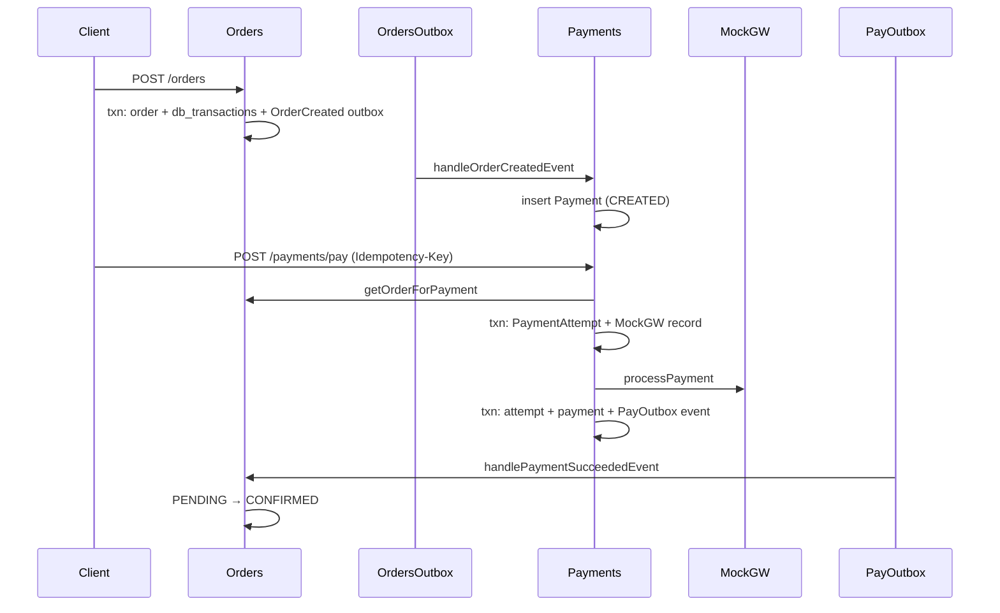

# Architecture and integration

## Placement in the monolith

| Piece | Database | Owned by |
|-------|----------|----------|
| `payments` | `payments_db` | Payments |
| `payment_attempts` | `payments_db` | Payments |
| `mock_gateway_transactions` | `payments_db` | Payments |
| `outbox` (payment events) | `payments_db` | Payments |
| `orders` / `outbox` (OrderCreated) | `orders_db` | Orders |

Modules never query each other's collections. Payments learns order totals via **`orders.getOrderForPayment(orderId, userId)`** at Pay Now time (trusted server-side amount). Order confirmation uses **`orders.handlePaymentSucceededEvent`** / **`handlePaymentFailedEvent`**, invoked from the payments outbox worker (same pattern as OrderCreated → Payments).

## End-to-end flow

## Schemas (summary)

### Payment (one per order)

- `orderId`, `userId`, `amount` (paise), `currency` (default `INR`)
- `status`: `CREATED` → `IN_PROGRESS` → `SUCCEEDED` | `FAILED`
- `attemptCount`: denormalized count of attempts created (not gateway retries)

**Indexes:** unique `{ orderId }`; `{ userId, createdAt }`; `{ status }`.

### PaymentAttempt (many per payment; never updated in place for retries)

- `paymentId`, `attemptNumber` (1..n)
- `gateway` (e.g. `MOCK`)
- `gatewayTransactionId` (from mock gateway; unique when set)
- `clientIdempotencyKey` (Pay Now header; unique per payment when present)
- `status`, `failureReason`

**Indexes:** unique `{ paymentId, attemptNumber }`; unique sparse `{ clientIdempotencyKey }` scoped with `paymentId`; unique sparse `{ gatewayTransactionId }`.

### Mock gateway ledger

Persists every simulated charge **before** the outcome is returned, so reconciliation can find `SUCCESS` even if the API process dies after the gateway answered.

### Payments outbox

Mirrors the Orders outbox worker contract: `PENDING` → `PROCESSING` → `PUBLISHED`, stale reclaim optional later.

Event types: `PaymentSucceeded`, `PaymentFailed`. Unique `{ aggregateId, eventType }` per payment so duplicate publishes are impossible at the DB layer.

## Transaction boundaries

| Operation | Session scope |
|-----------|----------------|
| OrderCreated consumer | Single-document create Payment (idempotent unique `orderId`) |
| Pay Now — reserve attempt | MongoDB transaction: conditional Payment status bump + insert PaymentAttempt |
| Pay Now — finalize | MongoDB transaction: update attempt + Payment + insert outbox (only if terminal success or exhausted retries) |
| Gateway call | **Outside** DB transaction (simulates network). UNKNOWN/TIMEOUT if we crash between gateway success and finalize txn |

## API surface (Payments public `index.js`)

- `handleOrderCreatedEvent` — outbox consumer
- `payNow({ orderId, userId, idempotencyKey, simulateOutcome? })` — HTTP + tests
- `reconcilePaymentAttempt(attemptId)` — repair UNKNOWN/TIMEOUT from mock ledger
- `startPaymentsOutboxWorker` — in-process publisher to Orders